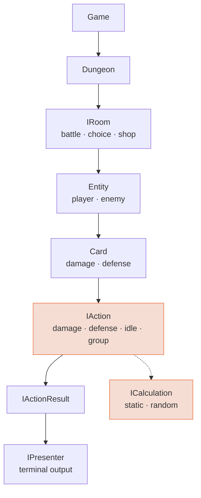

# 🃏 Terminal Spire

> A turn-based card roguelike that runs in the terminal. The game is the excuse — the point was to push object orientation until it either held up or broke.

I had just finished a book on object-oriented programming and wanted somewhere to apply it without an engine doing the thinking for me. A deck-building roguelike turned out to be a good target: cards, enemies, rooms and effects all vary along different axes, so a design that leans on inheritance alone falls apart within an hour.

Everything here is hand-written TypeScript. No game engine, no ECS library, no framework.

## How it fits together



Actions are the center of the design. Everything above them decides *what* happens; everything below decides *how much* and *how it reads*.

## The design

The system rests on a handful of abstractions, each with one job.

**Entities are anything that can act or be acted upon.** 🧍 Player and 👹 Enemy share a base that owns health, defense and identity, and nothing else. Neither knows how a turn works.

**Cards declare what they are, not how they render.** A card knows its id, name, description and cost, and is forced to implement how it plays. It knows nothing about the terminal.

**Actions are the unit of effect.** An action takes a performer and its targets, and returns results. Damage, defense and idle are the leaves — and a group of actions implements the same contract as a single one. A card that deals damage *and* grants defense is not a special case; it is one action that happens to contain two.

**Values may be fixed or rolled, and nothing above them cares.** Damage, defense and cost each delegate the actual number to a calculation. Static and random are two implementations of the same idea.

**Rooms decide what a floor does.** ⚔️ battle, 🔀 choice and 🛒 shop share one contract, so the dungeon walks its floors without knowing what it will find in them.

**Presenters turn state into text.** Nothing in the combat layer writes to the screen.

## Decisions worth explaining

### Randomness is a strategy, not a subclass

The first instinct is a damage card and a random damage card. That doubles for every axis — random cost, random defense, random anything — and collapses under its own weight before the game is playable.

Instead, a value holds a calculation and asks it for a number. Static and random are two implementations of one interface, and any value in the game can be either without a new card class existing anywhere.

### Actions return results instead of printing

Every action hands back a result and lets the presenter decide how to describe it. A composed action reports itself the same way a single one does, so the layer above never learns the difference.

This is what keeps combat testable and the output replaceable. Swapping the terminal for another surface means writing new presenters and touching nothing else.

### Generation is split by scope

The dungeon generator builds the dungeon and hands floors to a floor generator. Two levels, two responsibilities, each configurable on its own — the dungeon never needs to know how a floor gets populated.

## Running

```sh
npm install
npm start
```

Built with 🟦 TypeScript on 🟩 Node. Nothing else.

## Status

Written between August and October 2024, inspired by Slay the Spire. Playable but unfinished — the shop room and the enemy behaviors are the least developed parts. Kept as it is, because what it was for, it did.
