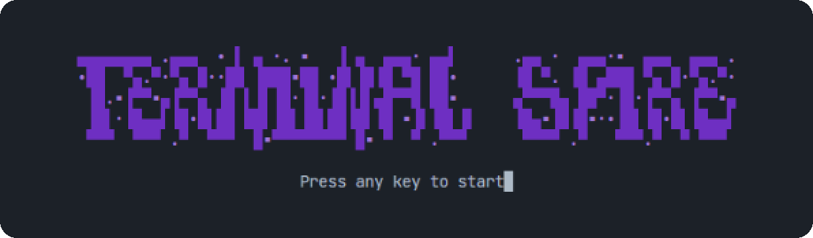
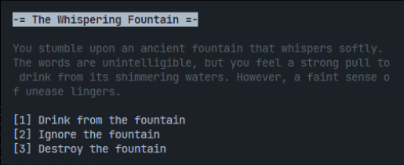
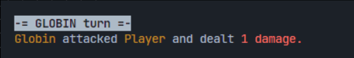

<p align="center">
  
</p>

<br>

<h3 align="center">A card roguelike that runs in the terminal.<br>Heavily inspired by Slay the Spire, written in plain TypeScript</h3>

<p align="center">
   <a href="https://github.com/Petri-Hub/terminal-spire/commits/master"></a>
</p>

<br>

## About

> **TL;DR:** an object orientation study. I had just finished a book on OO and wanted a project where inheritance alone wouldn't survive, and a deck-builder fits: cards, enemies, rooms and effects each vary on their own axis. No game engine and no framework, only two small libraries for colour and input.

<table>
  <tr>
    <td width="50%"></td>
    <td width="50%"></td>
  </tr>
</table>

## The three decisions that mattered

**🎲 Randomness had to be a strategy, not a subclass.** The obvious move is a damage card and a random damage card. Then you want random cost, and random defense, and the class tree doubles on every axis. So values delegate the number to a calculation instead — static and random are two implementations of the same thing, and no card class ever knows the difference.

**🧩 A group of actions is an action.** A card that deals damage *and* grants defense isn't a special case. The group implements the same contract as a single one, and returns the same kind of result, so nothing above ever branches on it.

**🖨️ Nothing in the combat layer writes to the screen.** Actions return results, presenters decide how to describe them. That's what makes the fight testable and the output swappable — moving off the terminal means writing new presenters and touching nothing else.

## What's inside

```sh
app
├── actions       # damage, defense, idle and grouped actions, each with its result
├── art           # the ASCII title screen
├── behaviors     # how an enemy picks its next action
├── calculations  # static and random strategies that values delegate to
├── cards         # damage and defense cards
├── cost          # card costs, static or random
├── damage        # damage values, static or random
├── defense       # defense values, static or random
├── dungeon       # dungeon and floor generation
├── helpers       # small utilities
├── interfaces    # the contracts the whole design is declared in
├── piles         # draw and used card piles
├── presenters    # turn cards, statuses and enemy intents into text
├── prompts       # terminal prompts: start screen, difficulty, card selection
├── resources     # difficulty presets
├── rooms         # battle, choice and shop rooms
├── types         # props and options for entities, cards and rooms
└── Game.ts       # the game loop, next to the player, enemy, deck and health bar classes
```

## Technologies

<table align="center">
  <tr>
    <td align="center" width="96"><br>TypeScript</td>
    <td align="center" width="96"><br>Node.js</td>
    <td align="center" width="96"><br>chalk</td>
    <td align="center" width="96"><br>Jest</td>
    <td align="center" width="96"><br>ESLint</td>
    <td align="center" width="96"><br>Prettier</td>
  </tr>
</table>

## Playing

It runs in any terminal with Node.js installed. Clone the repository, then:

```sh
npm install
npm run dev
```
